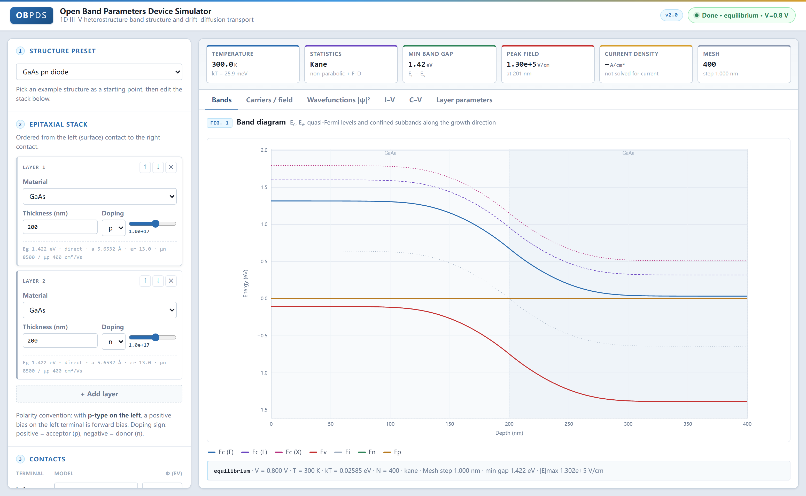
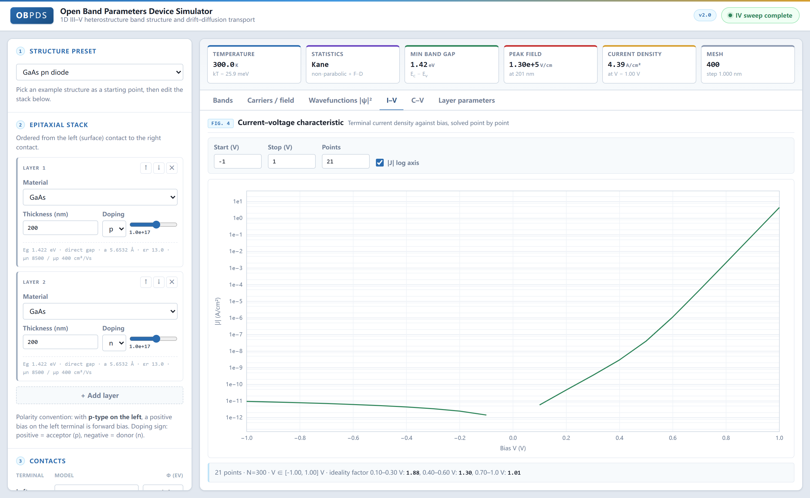

# OBPDS — Open Band Parameters Device Simulator

A one-dimensional band-structure and transport simulator for III-V compound
semiconductor heterostructures, with a web workbench for visualisation.

This project is a modern rewrite of [scott-maddox/obpds](https://github.com/scott-maddox/obpds)
(unmaintained since 2015, Python 2.7). It keeps that project's academic core —
Kane non-parabolic statistics, multiple valleys, damped Newton iteration — fixes
its physical and numerical defects, and adds the drift-diffusion transport the
original never had, so that I–V characteristics can be computed at all.



## Quick start

```bash
pip install -e ".[web]"
obpds-web                      # serves http://127.0.0.1:8000
# or
uvicorn web.app:app --reload
```

Solving from the command line:

```python
from obpds import Layer, OhmicContact, TwoTerminalDevice

dev = TwoTerminalDevice(
    [Layer(1000, "GaAs", Na=1e17),      # thickness in nm; Na acceptor, Nd donor
     Layer(1000, "GaAs", Nd=1e17)],
    [OhmicContact(), OhmicContact()],
    T=300, N=800, approx="kane",
)
sol = dev.get_equilibrium()             # equilibrium band diagram
dd  = dev.get_drift_diffusion(0.8)      # drift-diffusion; dd.J in A/cm^2
V, J = dev.get_iv(-0.5, 1.0, 31)        # I–V sweep
V, C = dev.get_cv(-1.0, 0.3, 41)        # C–V sweep
```

### Parameter calibration

When the tabulated values do not match a particular sample, `Layer` can override
the valence-band offset and the deformation potentials layer by layer:

```python
Layer(8, "GaInAs", composition=0.8, overrides={"VBO": -0.42, "b_shear": -1.9})
```

The overrides replace the **unstrained** tabulated values; substrate strain is
then applied on top of them as usual. Only these two classes of parameter are
exposed. Every other parameter feeds derived quantities — `ni`, `Nc`, `Nv`, the
non-parabolicity coefficient — and a half-updated set is worse than none, so
change those directly in `src/obpds/materials/data.py`. A misspelled key raises
`ValueError` rather than being silently ignored.

## Web workbench

`obpds-web` serves a single-page workbench that calls the same solver as the
Python API. The front end is hand-written HTML/CSS/JS with no build step, no CDN
and no bundler, so it runs offline and from a plain `uvicorn` reload. Every
simulation is dispatched to a worker thread and polled, which keeps the page
responsive and lets an I–V sweep report progress point by point.

| Panel | Contents |
| --- | --- |
| Structure preset | Seven ready-made stacks, from a GaAs pn diode to a strained InGaAs/GaAs quantum well |
| Epitaxial stack | Per-layer editor: material and alloy composition, thickness, p/n/i doping with a slider, live Eg / lattice constant / mobility readout |
| Contacts | Ohmic or Schottky per terminal, with the work function where the model uses it |
| Global parameters | Temperature, mesh size, statistics (Kane non-parabolic / Fermi–Dirac / Boltzmann), bias, p-side, substrate and strain reference, lifetimes, radiative coefficient |
| Results | Six metric cards (temperature, statistics, minimum gap, peak field, current density, mesh) over six tabs: bands, carriers and field, confined wavefunctions, I–V, C–V, layer parameters |

Every plot is inline SVG drawn from the same palette as the page, with layer
boundaries shaded, a hover crosshair readout and clickable legend entries.



## Physics

| Module | Contents |
| --- | --- |
| `fermi.py` | Fermi–Dirac integral `F_{1/2}` and the Kane generalised integral `H_{1/2} = G_{1/2} + 2αG_1`, Gauss–Legendre quadrature with the `t = u²` substitution, plus a tabulated/interpolated fast path (`generalized_fermi_fast`) with exact-quadrature fallback |
| `materials/` | Vurgaftman et al. (2001) parameters for 12 binary and 18 ternary III-V alloys, Adachi dielectric constants, Varshni `Eg(T)`, Γ/L/X valleys |
| `solver.py` | Finite-volume Poisson solve; the interface dielectric constant is the **harmonic mean** |
| `transport.py` | Drift-diffusion with Scharfetter–Gummel discretisation, Gummel iteration, SRH and radiative recombination |
| `newton.py` | Bank–Rose damped Newton with row-equilibration preconditioning |
| `quantum.py` | Self-consistent Schrödinger–Poisson: BenDaniel–Duke effective-mass equation, 2D subband occupation, continuum weight |
| `strain.py` | Pseudomorphic strain: biaxial strain tensor, Bir–Pikus valence-band splitting, hydrostatic shift, Matthews–Blakeslee critical thickness |

### Differences from the original implementation

1. **The ε-gradient term at heterointerfaces.** The original discretised
   `div(ε grad ψ)` as `ε d²ψ/dx²`, dropping `dε/dx · dψ/dx`. In the
   finite-volume form with the interface dielectric constant taken as the
   harmonic mean `ε_{i+1/2} = 2ε_i ε_{i+1}/(ε_i + ε_{i+1})`, that term is
   retained automatically.
2. **Generalised SG potentials.** Rather than assuming Boltzmann statistics,
   the generalised potentials are defined as
   `Psi_n = F_n − kT ln(n/Nc_ref)` and `Psi_p = F_p + kT ln(p/Nv_ref)`.
   These are identities for any statistics: they carry ψ, the band offsets, the
   DOS gradient and the degeneracy correction in one go, and they make the
   equilibrium current exactly zero.
3. **SRH trap densities.** The denominator must use the `n1`, `p1` belonging to
   the trap level (for a mid-gap trap, `n_eff = √(n0 p0)`), not the local
   equilibrium densities `n0`, `p0`. The latter amounts to letting the trap
   level slide with the Fermi level, which in the depletion region inflates the
   denominator by five orders of magnitude and makes the reverse current far
   too small and nearly bias-independent.
4. **Reference state for recombination.** The driving force is `np − n0·p0`
   rather than `np − ni²`: under Kane or Fermi–Dirac statistics `np ≠ ni²` at
   equilibrium, and the residual would fake a saturation current.
5. **Initial quasi-Fermi levels.** The metallurgical junction is located where
   the net doping **changes sign** (not at the "first n-type point"), and the
   minority profile uses the logarithmic form
   `c(s) = c0(e^{V/kT}(1−s) + s)`, which holds under both forward and reverse
   bias.
6. **No bias continuation.** An ohmic contact pins the carrier **density**, not
   the quasi-Fermi level; reusing the previous bias point's level would put a
   factor `e^{ΔV/kT}` into the contact density, and the first nonlinear Poisson
   solve diverges. A cold start converges in 2–3 Gummel iterations.
7. **Terminal current is taken from the depletion region.** The quasi-neutral
   region carries current as `q μ c dF/dx`; at `c ~ 1e17`, the gradient
   corresponding to 1e-15 A/cm² is five orders of magnitude below the round-off
   of the stored level, so those cells are pure noise. The depletion-region
   links are selected with a *local* `ni` threshold over *both* endpoints (a
   global `ni.max()` mis-classifies links on gap-contrast heterostructures), and
   every `TransportSolution` carries the diagnostics that let a caller judge the
   result: `J_spread` (worst-link deviation), `J_reliable` (whether the current
   is above the noise floor), the three finite-volume conservation balances
   (`continuity_balance_electron/_hole/_total`) and the net integrated charge
   (`net_charge`).

## Quantum correction (self-consistent Schrödinger–Poisson)

A classical Poisson solve piles the electron gas onto the local minimum of the
conduction-band edge, which is physically wrong in a semiconductor: electrons in
a channel are confined to a potential well a few nm wide, their lowest level
lies above the band edge, and the charge centroid sits several nm **behind** the
interface. Tick "quantum correction" in the web interface (equilibrium band
diagram mode only) or call

```python
sol = dev.get_quantum_equilibrium(n_states=8)
sol.subbands["levels_eV"]          # eigenenergies
sol.subbands["sheet_density_cm2"]  # 2DEG sheet density
sol.subbands["psi"]                # wavefunction of each bound state
```

Implementation notes:

- **BenDaniel–Duke form** `−(ħ²/2) d/dx(1/m* dφ/dx) + Ec φ = Eφ`, with `1/m*` at
  an interface taken as the harmonic mean — the same series argument as for the
  dielectric constant. The discretised operator is symmetric tridiagonal, and
  `eigh_tridiagonal` returns the lowest few eigenstates.
- **Bound-state criterion**: `E < E_cut`, where `E_cut` is the lower of the two
  contact band edges. An electron above it can escape into one of the contacts,
  so it is not bound.
- **2D occupation**: the two-dimensional Fermi–Dirac integral is just
  `ln(1 + e^η)`, so the subband sheet density
  `N_i = (m* kT/πħ²) ln(1 + e^{(F−E_i)/kT})` is exact for degenerate statistics
  too, with no quadrature needed.
- **Continuum**: states above `E_cut` are still treated as three-dimensional,
  with weight `Q(3/2, (E_cut−Ec)/kT)` (regularised incomplete gamma). This is
  the closed form of the Boltzmann limit, which guarantees a smooth transition
  back to the classical result outside the well. Under degenerate
  (Fermi–Dirac) statistics the weight is an approximation: `validate_continuum.py`
  quantifies it — exact to <1e-5 in the Boltzmann limit, worst ~4% of the total
  sheet density on a real AlGaAs/GaAs HEMT.
- **Gummel iteration**: the inner Newton solve holds the quantum density fixed
  while the outer loop refreshes the subbands. Undamped, each step contracts by
  about ×0.78 — it is already a contraction mapping — so the step length is
  rolled back only when an overshoot appears.

Known limits: `n_states` caps the number of subbands in the sum, so a wide well
(such as the near-surface well formed under a heavily doped cap) needs a larger
`n_states` before the subband sum converges to the 3D result; only Γ-valley
electrons are quantised in the channel, holes are not; and no exchange-correlation
correction is applied inside the well.

## Pseudomorphic strain

An epitaxial layer thinner than the critical thickness cannot relax: it is
locked to the in-plane lattice constant of the substrate and compensates with
out-of-plane strain. Specify a substrate to enable it (`substrate="GaAs"`, or
give a lattice constant; growth direction is [001]):

```python
dev = TwoTerminalDevice([Layer(20, "GaAs", Nd=1e17),
                         Layer(8, "GaInAs", composition=0.8),   # In0.2Ga0.8As
                         Layer(20, "GaAs", Nd=1e17)],
                        substrate="GaAs")
sol = dev.get_quantum_equilibrium()
# gap opens by ~70 meV, heavy hole moves ~80 meV above the light hole,
# 2DEG in the well ~6e11 cm^-2
```

- **Strain state**: `eps_in = (a_sub − a_layer)/a_layer`,
  `eps_out = −2(C12/C11)·eps_in` (free surface, `sigma_zz = 0`).
- **Conduction band**: hydrostatic term only, `δEc = a_c·Tr(ε)`. The same `a_c`
  is used for Γ/L/X.
- **Valence band**: Bir–Pikus strain Hamiltonian plus spin–orbit coupling. The
  |3/2,±3/2> block is diagonal; |3/2,±1/2> and |1/2,±1/2> form a 2×2 block.
  With

      h = a_v·Tr(ε),  d = −2b(ε⊥ − ε∥),  s = sqrt(Δ² − Δ·d + 9d²/4)

  the edges are `E_hh = Ev + h + d/2`, `E_lh = Ev + h − Δ/2 − d/4 + s/2` and
  `E_so = Ev + h − Δ/2 − d/4 − s/2`. Without strain this reduces exactly to
  `E_hh = E_lh = Ev` and `E_so = Ev − Δ`; the shear part is traceless, so the
  sum of the three is independent of `d`.
- **Density of states**: after the split, the light hole withdraws from the
  valence-band DOS gradually as `exp(−(E_top−E_lh)/kT)`, and without a split the
  expression returns exactly to `(m_hh^{3/2} + m_lh^{3/2})`, with no
  discontinuity.
- **Critical thickness**: Matthews–Blakeslee (60° dislocation, `b = a/√2`,
  `ν = C12/(C11+C12)`) solved as a fixed point. It is reported, not applied —
  a layer beyond h_c is flagged ⚠ rather than silently treated as partially
  relaxed.

Deformation potentials follow the Van de Walle / Chuang convention (`a_v > 0`,
`δEg = (a_c − a_v)·Tr(ε)`), which gives `dEg/dP = 11.0 meV/kbar` for GaAs
against a measured 10.8. The Vurgaftman tables print `a_v` with the opposite
sign and write the gap shift as `(a_c + a_v)`; the two are numerically
equivalent.

Known limits: L/X valleys share the same `a_c` and are not shear-split (that
needs `Ξ_u`); effective masses do not change with strain (under [001] strain the
heavy-hole mass is in fact anisotropic); relaxation is not modelled; piezoelectric
charge exists only for [111] growth and is not modelled; the nitrides have
elastic constants but no deformation potentials, so strain is computed but the
bands do not move, and the layer table flags this.

## Repository layout

| Path | Contents |
| --- | --- |
| `src/obpds/` | The solver: `layer.py` and `device.py` (stack and contacts), `solver.py` (Poisson, equilibrium, zero-current), `transport.py` (drift–diffusion, I–V, C–V), `newton.py` (damped Newton), `quantum.py` (Schrödinger–Poisson), `strain.py` (Bir–Pikus, Matthews–Blakeslee), `fermi.py`, `materials/` |
| `src/web/` | `app.py` (FastAPI: job queue, `/api/solve`, `/api/sweep`, `/api/describe`) and `static/` — the three front-end files |
| `tests/` | The validation suites (`validate_*.py`), the in-process API contract test, and `dev/` for throwaway diagnostics |
| `examples/` | `comprehensive_run.py` and its pinned output for diffing |
| `docs/` | Screenshots used in this README |

## Validation

One command runs the whole suite, split into three marked classes:

```bash
python -m pytest                 # everything
python -m pytest -m unit         # fast pure-function checks (Fermi table)
python -m pytest -m physics      # solver validation against closed forms (slow)
python -m pytest -m api          # web-API contract tests (in-process TestClient)
```

The underlying verification scripts can also be run directly (their stdout is
the reproducible `paper/cpc/data/*.out` artefact):

```bash
python tests/validate_physics.py     # classical: against analytical results
python tests/validate_quantum.py     # quantum:  against analytical results
python tests/validate_strain.py      # strain:   against analytical results
python tests/validate_fermi.py       # tabulated Fermi integral vs quadrature
python tests/validate_continuum.py   # continuum-compensation approximation
python tests/web_smoke.py            # web API end to end (start the server first)
```

`tests/dev/` holds the throwaway diagnostic scripts written while debugging the
solver; they are not part of the suite (see `tests/dev/README.md`).

Analytical results checked by `validate_physics.py`: built-in potential,
depletion width and peak field (depletion approximation), ΔEc/ΔEg = 0.62 for
AlGaAs/GaAs, the short-base diode
`J = q ni²(Dn/WpNa + Dp/WnNd) e^{V/kT}`, the two-region ideality factor
(SRH n≈2 at low bias → diffusion n≈1 at high bias), reverse current scaling as
1/τ, and zero equilibrium current.

Analytical results checked by `validate_quantum.py`: levels of the square well
and the triangular well (Airy zeros, including the `F·h` offset from placing the
Dirichlet wall one cell outside the mesh), the analytic spectrum of the
BenDaniel–Duke mass-step well (transcendental equation solved numerically), the
Boltzmann and degenerate limits of 2D occupation, and physical arguments for the
self-consistent loop — on a pn junction the quantum result must match the
classical one **point by point** with no spurious bound states; for a HEMT the
sheet density must land in the 1e12 range, the channel centroid about 5 nm
behind the interface, the quantum channel charge no larger than the classical
one, and the ground state below the Airy estimate of the bare triangular well.

Analytical results checked by `validate_strain.py`: exact HH/LH degeneracy in the
unstrained limit with SO exactly `Δ_so` below; the shear part traceless (the sum
of the three edges independent of the splitting `d`); as `Δ_so → ∞` the HH–LH
splitting tends to `d = −2b(ε⊥−ε∥)` with an error falling as `1/Δ_so` (that
convergence order is asserted separately); the hydrostatic coefficient
`dEg/dP = −(a_c−a_v)/B` lands in 5–20 meV/kbar with GaAs matching the measured
10.8; In₀.₅₃Ga₀.₄₇As is lattice-matched to InP; and the critical thickness falls
monotonically with mismatch.

## A full example run

```bash
python examples/comprehensive_run.py        # about a minute; diff against the .out file
```

It runs equilibrium bands, drift-diffusion, I–V, C–V, the quantum correction and
strain in turn, printing fixed text blocks that can be diffed directly against
`examples/comprehensive_run.out`. This is the example shipped to reviewers in the
submission package.

## Licence

AGPL-3.0-or-later, matching the original project; the full text is in `LICENSE`.
Copyright in the material parameter tables remains with their respective authors;
see `src/obpds/materials/data.py`.
